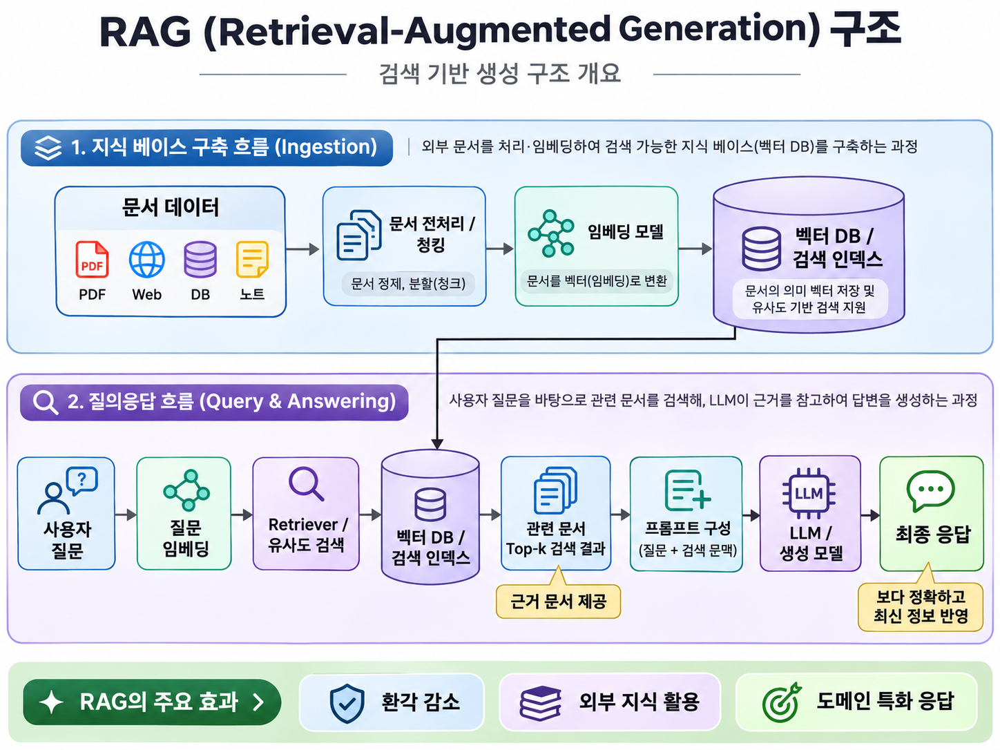

# 간단한 RAG 구성해보기
## 1. 검색 증강 생성 RAG(Retrieval-Augmented Generation)
RAG는 Retrieval-Augmented Generation의 약자로, 한국어로는 ‘검색 증강 생성’이라고 한다.
질문과 관련된 정보를 외부 문서나 데이터베이스에서 검색한 뒤, 그 정보를 대규모 언어 모델(LLM)에 제공하여 답변을 생성하는 방식이다.
핵심은 모델이 학습한 지식에만 의존하지 않고, 답변 시점에 찾아온 자료를 함께 활용한다는 것이다.

## 2. 큰 구조



위의 그림을 보면 알겠지만 먼저 지식 베이스 구축 단계와 질의 응답 단계로 나뉠 수 있다.

### 1) 지식 베이스 구축
LLM이 답변을 생성할 때 참고할 자료들을 모아서 DB화 해놓는다.   
굳이 Vector DB는 아니어도 문서를 갖고오는데 문제없다면 상관없다.  
하지만 일반적으로는 Vector DB를 많이 사용하는데 이는 동일한 단어 없이도 문맥과 맥락만 맞으면 해당 문서를 찾아올 수
있기 때문이다.

Vector DB를 쓰기 위해서는 대상 문서들을 Vector로 Embedding해야한다.  
이때 Vector의 차원은 모델에 따라 달라지며 모델에 따라 하나의 문서가 하나의 다차원 벡터일 수도 혹은 다수의 다차원 벡터로 이루어질수있다.
벡터 한개당 하나의 문서일 경우 Single Vector, 다수의 벡터당 문서 하나일 경우 Multi Vector라고 하며
일반적으로 정확도는 Multi Vector가 높고, Single Vector가 좀 더 빠르다.

### 2) 질의 응답
LLM에 질문을 넣으면 질문을 Embedding하여 Vector 검색하여 문서를 가져온 후 LLM에 질문과 같이 넣어서 응답을 생성한다.   
당연하지만 문서를 Embedding할때 쓰던 모델로 동일하게 Embedding해서 검색해야한다.

## 3. 실습 코드
실습은 Python으로 구성하는게 가장 쉽다.
faiss library를 이용하여 벡터 검색 지식 베이스를 구축하고 베이스에서 문서를 검색하여 API KEY를 통해
다른 LLM에 전달하여 답변할 수 있게 하면 되기 때문이다.

아래는 LangChain으로 간단하게 구성해본 예시 프로그램이다.   
별도의 IVF나 HNSW와 같은 ANN(Approximate Nearest Neighbor)방식이 아닌 FLAT 방식으로 ENN(Exactly Nearest Neighbor) 검색이다.
```python
from dotenv import load_dotenv

from langchain_core.documents import Document
from langchain_core.prompts import ChatPromptTemplate
from langchain_core.output_parsers import StrOutputParser
from langchain_core.runnables import RunnableLambda, RunnablePassthrough

from langchain_openai import OpenAIEmbeddings, ChatOpenAI
from langchain_community.vectorstores import FAISS
from langchain_text_splitters import RecursiveCharacterTextSplitter

# 1. 환경변수 로드
load_dotenv()

# 2. 문서 데이터 준비
documents = [
    Document(
        page_content="RAG는 외부 문서를 검색한 후, 해당 정보를 LLM에 제공하여 답변을 생성하는 기술입니다.",
        metadata={"source": "rag.txt"}
    ),
    Document(
        page_content="FAISS는 고차원 벡터에 대한 유사도 검색을 수행하는 라이브러리입니다. RAG에서 관련 문서를 찾는 데 활용됩니다.",
        metadata={"source": "faiss.txt"}
    ),
    Document(
        page_content="LangChain은 LLM, 임베딩 모델, 검색기 및 프롬프트를 연결하는 프레임워크입니다.",
        metadata={"source": "langchain.txt"}
    ),
    Document(
        page_content="OpenAI의 임베딩 모델은 텍스트를 벡터로 변환하며, Chat 모델은 입력된 문맥을 바탕으로 답변을 생성합니다.",
        metadata={"source": "openai.txt"}
    ),
]


# 3. 문서 분할
splitter = RecursiveCharacterTextSplitter(
    chunk_size=300,
    chunk_overlap=30
)
chunks = splitter.split_documents(documents)


# 4. 임베딩 모델
embeddings = OpenAIEmbeddings(
    model="text-embedding-3-small"
)


# 5. FAISS 벡터 인덱스 생성
vectorstore = FAISS.from_documents(
    documents=chunks,
    embedding=embeddings
)


# 6. Retriever 설정
retriever = vectorstore.as_retriever(
    search_type="similarity",
    search_kwargs={"k": 2}
)


# 7. 검색 문서를 문자열로 변환
def format_docs(docs):
    return "\n\n".join(
        f"출처: {doc.metadata.get('source')}\n{doc.page_content}"
        for doc in docs
    )


# 8. 프롬프트 정의
prompt = ChatPromptTemplate.from_messages([
    (
        "system",
        "당신은 RAG 기반 AI 어시스턴트입니다.\n"
        "아래 참고 문서만 근거로 질문에 답변하세요.\n"
        "문서에 답이 없다면 모른다고 답변하세요.\n\n"
        "참고 문서:\n{context}"
    ),
    ("human", "{question}")
])


# 9. LLM 생성
llm = ChatOpenAI(
    model="gpt-4.1-mini",
    temperature=0
)


# 10. LangChain RAG Chain
rag_chain = (
    {
        "context": retriever | RunnableLambda(format_docs),
        "question": RunnablePassthrough()
    }
    | prompt
    | llm
    | StrOutputParser()
)


# 11. 질의 실행
if __name__ == "__main__":
    question = "RAG에서 FAISS는 어떤 역할을 하나요?"

    answer = rag_chain.invoke(question)

    print("질문:", question)
    print("답변:", answer)
```

일정 이상까지는 BruteForce(FLAT) 방식이 더 빠르다.   
하지만 일정 이상 문서의 개수가 넘어간다면 FLAT 방식으로는 QPS(Query per second)가 안나온다.
때문에 이 시점에서 IVF이든 HNSW이던 선택해야한다.   
관련 연구 논문은 [이 곳](https://arxiv.org/abs/2409.06464v1) 을 참고하면 좋다.   
각 테스트 데이터셋별 인덱스 방식에 따라 QPS가 얼마나 나오는지에 대해 연구한 논문이다.   
IVF나 HNSW 방식등 ANNs의 세부적인 내용은 [이 곳](https://blakewoo.github.io/posts/VectorDB-ANNs/) 을 참고하라.

### 1) IVF 로 구동시
위의 코드에서 Vector 검색하는 부분을 IVF 방식으로 변경하면 된다.   
이 IVF도 그냥 FLAT하게 모든 VECTOR를 클러스터링만 하는 방식이 있고, PQ 압축을 통해 제공하는 방식이 있다. 
아래의 코드는 FLAT한 IVF로 클러스터를 구성하는 예시코드이다.

```python
from dotenv import load_dotenv

from langchain_core.documents import Document
from langchain_core.prompts import ChatPromptTemplate
from langchain_core.output_parsers import StrOutputParser
from langchain_core.runnables import RunnableLambda, RunnablePassthrough

from langchain_openai import OpenAIEmbeddings, ChatOpenAI
from langchain_community.vectorstores import FAISS
from langchain_text_splitters import RecursiveCharacterTextSplitter
from langchain_community.docstore.in_memory import InMemoryDocstore

# 1. 환경변수 로드
load_dotenv()


# 2. 문서 데이터 준비
documents = [
  Document(
    page_content="RAG는 외부 문서를 검색한 후, 해당 정보를 LLM에 제공하여 답변을 생성하는 기술입니다.",
    metadata={"source": "rag.txt"}
  ),
  Document(
    page_content="FAISS는 고차원 벡터에 대한 유사도 검색을 수행하는 라이브러리입니다. RAG에서 관련 문서를 찾는 데 활용됩니다.",
    metadata={"source": "faiss.txt"}
  ),
  Document(
    page_content="LangChain은 LLM, 임베딩 모델, 검색기 및 프롬프트를 연결하는 프레임워크입니다.",
    metadata={"source": "langchain.txt"}
  ),
  Document(
    page_content="OpenAI의 임베딩 모델은 텍스트를 벡터로 변환하며, Chat 모델은 입력된 문맥을 바탕으로 답변을 생성합니다.",
    metadata={"source": "openai.txt"}
  ),
]


# 3. 문서 분할
splitter = RecursiveCharacterTextSplitter(
  chunk_size=300,
  chunk_overlap=30
)
chunks = splitter.split_documents(documents)

# 임베딩 생성
embeddings = OpenAIEmbeddings(
  model="text-embedding-3-small"
)

texts = [doc.page_content for doc in chunks]
vectors = embeddings.embed_documents(texts)

data = np.ascontiguousarray(
  np.asarray(vectors, dtype=np.float32)
)

dim = data.shape[1]

# IVF 인덱스 구성
nlist = 2
nprobe = 1

quantizer = faiss.IndexFlatL2(dim)

index = faiss.IndexIVFFlat(
  quantizer,
  dim,
  nlist,
  faiss.METRIC_L2
)

# IVF 클러스터 학습
index.train(data)
index.nprobe = nprobe

# LangChain FAISS 연결
vectorstore = FAISS(
  embedding_function=embeddings,
  index=index,
  docstore=InMemoryDocstore(),
  index_to_docstore_id={}
)

# 이미 계산한 임베딩 사용 (중복 API 호출 방지)
vectorstore.add_embeddings(
  text_embeddings=list(zip(texts, vectors)),
  metadatas=[doc.metadata for doc in chunks]
)

retriever = vectorstore.as_retriever(
  search_kwargs={"k": 2}
)

# 7. 검색 문서를 문자열로 변환
def format_docs(docs):
  return "\n\n".join(
    f"출처: {doc.metadata.get('source')}\n{doc.page_content}"
    for doc in docs
  )


# 8. 프롬프트 정의
prompt = ChatPromptTemplate.from_messages([
  (
    "system",
    "당신은 RAG 기반 AI 어시스턴트입니다.\n"
    "아래 참고 문서만 근거로 질문에 답변하세요.\n"
    "문서에 답이 없다면 모른다고 답변하세요.\n\n"
    "참고 문서:\n{context}"
  ),
  ("human", "{question}")
])


# 9. LLM 생성
llm = ChatOpenAI(
  model="gpt-4.1-mini",
  temperature=0
)


# 10. LangChain RAG Chain
rag_chain = (
  {
    "context": retriever | RunnableLambda(format_docs),
    "question": RunnablePassthrough()
  }
  | prompt
  | llm
  | StrOutputParser()
)


# 11. 질의 실행
if __name__ == "__main__":
  question = "RAG에서 FAISS는 어떤 역할을 하나요?"

  answer = rag_chain.invoke(question)

  print("질문:", question)
  print("답변:", answer)
```


### 2) HNSW 로 구동시
직전 IVF 코드에서 IVF 부분을 HNSW로 바꿔주면 된다.

```python
from dotenv import load_dotenv

from langchain_core.documents import Document
from langchain_core.prompts import ChatPromptTemplate
from langchain_core.output_parsers import StrOutputParser
from langchain_core.runnables import RunnableLambda, RunnablePassthrough

from langchain_openai import OpenAIEmbeddings, ChatOpenAI
from langchain_community.vectorstores import FAISS
from langchain_text_splitters import RecursiveCharacterTextSplitter
from langchain_community.docstore.in_memory import InMemoryDocstore

# 1. 환경변수 로드
load_dotenv()


# 2. 문서 데이터 준비
documents = [
  Document(
    page_content="RAG는 외부 문서를 검색한 후, 해당 정보를 LLM에 제공하여 답변을 생성하는 기술입니다.",
    metadata={"source": "rag.txt"}
  ),
  Document(
    page_content="FAISS는 고차원 벡터에 대한 유사도 검색을 수행하는 라이브러리입니다. RAG에서 관련 문서를 찾는 데 활용됩니다.",
    metadata={"source": "faiss.txt"}
  ),
  Document(
    page_content="LangChain은 LLM, 임베딩 모델, 검색기 및 프롬프트를 연결하는 프레임워크입니다.",
    metadata={"source": "langchain.txt"}
  ),
  Document(
    page_content="OpenAI의 임베딩 모델은 텍스트를 벡터로 변환하며, Chat 모델은 입력된 문맥을 바탕으로 답변을 생성합니다.",
    metadata={"source": "openai.txt"}
  ),
]


# 3. 문서 분할
splitter = RecursiveCharacterTextSplitter(
  chunk_size=300,
  chunk_overlap=30
)
chunks = splitter.split_documents(documents)

# 임베딩 생성
embeddings = OpenAIEmbeddings(
  model="text-embedding-3-small"
)

texts = [doc.page_content for doc in chunks]
vectors = embeddings.embed_documents(texts)

data = np.ascontiguousarray(
  np.asarray(vectors, dtype=np.float32)
)

dim = data.shape[1]

# HNSW 인덱스 구성
M = 16
ef_construction = 40
ef_search = 32

index = faiss.IndexHNSWFlat(
  dim,
  M,
  faiss.METRIC_L2
)

index.hnsw.efConstruction = ef_construction
index.hnsw.efSearch = ef_search

# LangChain FAISS 연결
vectorstore = FAISS(
  embedding_function=embeddings,
  index=index,
  docstore=InMemoryDocstore(),
  index_to_docstore_id={}
)

# 이미 계산한 임베딩 사용 (중복 API 호출 방지)
vectorstore.add_embeddings(
  text_embeddings=list(zip(texts, vectors)),
  metadatas=[doc.metadata for doc in chunks]
)

retriever = vectorstore.as_retriever(
  search_kwargs={"k": 2}
)

# 7. 검색 문서를 문자열로 변환
def format_docs(docs):
  return "\n\n".join(
    f"출처: {doc.metadata.get('source')}\n{doc.page_content}"
    for doc in docs
  )


# 8. 프롬프트 정의
prompt = ChatPromptTemplate.from_messages([
  (
    "system",
    "당신은 RAG 기반 AI 어시스턴트입니다.\n"
    "아래 참고 문서만 근거로 질문에 답변하세요.\n"
    "문서에 답이 없다면 모른다고 답변하세요.\n\n"
    "참고 문서:\n{context}"
  ),
  ("human", "{question}")
])


# 9. LLM 생성
llm = ChatOpenAI(
  model="gpt-4.1-mini",
  temperature=0
)


# 10. LangChain RAG Chain
rag_chain = (
  {
    "context": retriever | RunnableLambda(format_docs),
    "question": RunnablePassthrough()
  }
  | prompt
  | llm
  | StrOutputParser()
)


# 11. 질의 실행
if __name__ == "__main__":
  question = "RAG에서 FAISS는 어떤 역할을 하나요?"

  answer = rag_chain.invoke(question)

  print("질문:", question)
  print("답변:", answer)
```

### 3) 외부 CSV 파일을 DOCUMENT로 쓰고 싶을때
현재 경로에 있는 news.csv를 가져와서 document로 쓰고 싶다고해보자. 그러면 아래와 같이 document를 지정해서 load해온뒤 사용하면 된다.

```python
from dotenv import load_dotenv

from langchain_core.documents import Document
from langchain_core.prompts import ChatPromptTemplate
from langchain_core.output_parsers import StrOutputParser
from langchain_core.runnables import RunnableLambda, RunnablePassthrough

from langchain_openai import OpenAIEmbeddings, ChatOpenAI
from langchain_community.vectorstores import FAISS
from langchain_text_splitters import RecursiveCharacterTextSplitter
from langchain_community.docstore.in_memory import InMemoryDocstore
from langchain_community.document_loaders import CSVLoader
# 1. 환경변수 로드
load_dotenv()


# 2. 문서 데이터 준비 - news.csv 파일
loader = CSVLoader(
  file_path="./news.csv",
  encoding="utf-8-sig"
)

documents = loader.load()

print(f"문서 개수: {len(documents)}")
print(documents[0])

# 3. 문서 분할
splitter = RecursiveCharacterTextSplitter(
  chunk_size=300,
  chunk_overlap=30
)
chunks = splitter.split_documents(documents)

# 임베딩 생성
embeddings = OpenAIEmbeddings(
  model="text-embedding-3-small"
)

texts = [doc.page_content for doc in chunks]
vectors = embeddings.embed_documents(texts)

data = np.ascontiguousarray(
  np.asarray(vectors, dtype=np.float32)
)

dim = data.shape[1]

# HNSW 인덱스 구성
M = 16
ef_construction = 40
ef_search = 32

index = faiss.IndexHNSWFlat(
  dim,
  M,
  faiss.METRIC_L2
)

index.hnsw.efConstruction = ef_construction
index.hnsw.efSearch = ef_search

# LangChain FAISS 연결
vectorstore = FAISS(
  embedding_function=embeddings,
  index=index,
  docstore=InMemoryDocstore(),
  index_to_docstore_id={}
)

# 이미 계산한 임베딩 사용 (중복 API 호출 방지)
vectorstore.add_embeddings(
  text_embeddings=list(zip(texts, vectors)),
  metadatas=[doc.metadata for doc in chunks]
)

retriever = vectorstore.as_retriever(
  search_kwargs={"k": 2}
)

# 7. 검색 문서를 문자열로 변환
def format_docs(docs):
  return "\n\n".join(
    f"출처: {doc.metadata.get('source')}\n{doc.page_content}"
    for doc in docs
  )


# 8. 프롬프트 정의
prompt = ChatPromptTemplate.from_messages([
  (
    "system",
    "당신은 RAG 기반 AI 어시스턴트입니다.\n"
    "아래 참고 문서만 근거로 질문에 답변하세요.\n"
    "문서에 답이 없다면 모른다고 답변하세요.\n\n"
    "참고 문서:\n{context}"
  ),
  ("human", "{question}")
])


# 9. LLM 생성
llm = ChatOpenAI(
  model="gpt-4.1-mini",
  temperature=0
)


# 10. LangChain RAG Chain
rag_chain = (
  {
    "context": retriever | RunnableLambda(format_docs),
    "question": RunnablePassthrough()
  }
  | prompt
  | llm
  | StrOutputParser()
)


# 11. 질의 실행
if __name__ == "__main__":
  question = "RAG에서 FAISS는 어떤 역할을 하나요?"

  answer = rag_chain.invoke(question)

  print("질문:", question)
  print("답변:", answer)
```

# 참고문헌
- Klesel, M., Wittmann, H.F. Retrieval-Augmented Generation (RAG). Bus Inf Syst Eng 67, 551–561 (2025). https://doi.org/10.1007/s12599-025-00945-3
- [FAISS 공식 github](https://github.com/facebookresearch/faiss/wiki)
- [Langchain 공식 사이트](https://docs.langchain.com/oss/python/langchain/quickstart)
- Jimmy Lin, . "Operational Advice for Dense and Sparse Retrievers: HNSW, Flat, or Inverted Indexes?." (2024).

